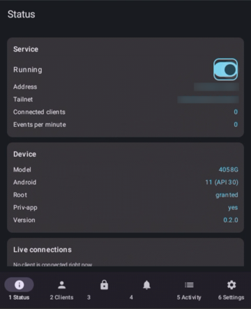
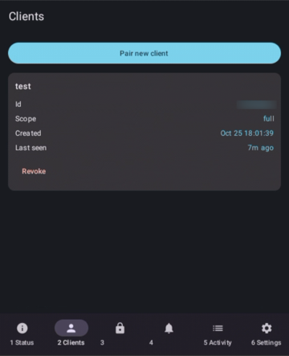
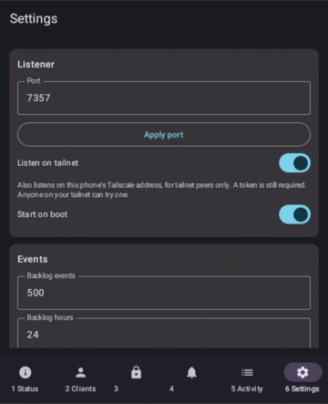

# MMM — Magnificent Modern Modemizer

All of Android, from Python.

MMM is one Android app that exposes the **whole Android Java API** over a small
reflection RPC, so a phone becomes a programmable modem without giving up being a
phone: Android stays installed and keeps running the radio, the SIM, charging and
call audio.

Termux:API gives you about fifty hand-picked commands, can't react to events, and
can't reach privileged APIs. MMM has no list.

```python
from mmm import Android

a = Android()
print(a.cls("android.os.Build").MODEL)

tm = a.context.getSystemService("phone")
print(tm.getSignalStrength().getLevel())

@a.on("android.provider.Telephony.SMS_RECEIVED", durable="sms")
def got(intent):
    print(intent["extras"])

a.run()
```

```sh
mmm status
mmm call android.os.Build getRadioVersion
mmm watch android.provider.Telephony.SMS_RECEIVED --durable sms
mmm repl
mmm mcp        # an MCP server, so an AI assistant can use the phone
mmm ui         # a web UI, plus rules: a text, a picture or a phone event runs a command here
```

The common jobs also come as plain functions in `mmm.android`, shared by the web UI,
the MCP server and your scripts:

```python
from mmm import Android
from mmm.android import apps, network, sms

a = Android()
sms.send(a, "+15550100199", "hello")
sms.send_mms(a, "+15550100199", open("cat.jpg", "rb").read(), "cat.jpg", "image/jpeg", "look")
print(network.wifi(a)["ssid"])                    # root
apps.set_enabled(a, "com.example.bloat", False)   # root; reversible pm disable-user
```

## Screenshots

The app on a keypad flip phone (TCL Flip 2), mirrored with scrcpy:

| Status | Clients | Settings |
|---|---|---|
|  |  |  |

The web client on the computer, `mmm ui` ([more](docs/ui.md)):

| Messages | Rules |
|---|---|
|  |  |
| **Phone** | **Mac** |
|  |  |

It also has Calls, Notifications, Apps, Network, Android settings and a Console page.
Messages sends pictures as MMS, and pictures texted to the phone reach your rules.

## What is in here

| | |
|---|---|
| `app/` | the Android app: RPC engine, event hub, tokens, and a Material 3 config UI that works with touch **and** a D-pad, so it suits keypad flip phones too |
| `magisk/` | an optional Magisk module that installs MMM as a priv-app, with its permission allowlist generated from the manifest |
| `client/` | the Python client: library (curated helpers in `mmm.android`), `mmm` CLI, MCP server, and `mmm serve` (rules and the web UI) — no dependencies, so it installs on Termux |
| `docs/` | the documentation site, including the design spec |

## Install

```sh
# the app: grab mmm-<version>.apk from the releases page
adb install -r -g mmm-<version>.apk   # an update restarts the service by itself

# the client (released on its own, as "MMM client" on the same page)
pip install "git+https://github.com/lubabs770/mmm#subdirectory=client"
```

Then open MMM, turn the service on, pair a client on the **Clients** screen, and:

```sh
mmm pair <token>                               # in Termux, on the phone
mmm pair <token> --ssh phone --ssh-port 8022   # from a computer, through sshd
mmm pair <token> --adb                         # from a computer, over USB
mmm pair <token> --tailnet phone               # from a computer on your tailnet
```

[Install guide](docs/install.md) · [Pairing](docs/pairing.md) ·
[Python guide](docs/python.md) · [Protocol](docs/protocol.md) ·
[Recipes](docs/recipes.md) · [MCP](docs/mcp.md) · [Web UI and rules](docs/ui.md) ·
[Security model](docs/security.md) · [Design spec](docs/spec.md)

## How it works

```
 Linux computer                 Phone
 ┌──────────────┐      ┌─────────────────────────────────────┐
 │ python: mmm  │─ssh─>│ Termux sshd ─┐                      │
 │ CLI:    mmm  │ -L   │              v                      │
 └──────────────┘      │ 127.0.0.1:7357  <── Termux: mmm     │
   (or adb forward)    │      │                              │
                       │ MMM app (foreground service)        │
                       │  ├ RPC engine (reflection)          │
                       │  ├ Handle table (per session)       │
                       │  ├ Event hub (broadcasts, proxies,  │
                       │  │            backlog ring buffer)  │
                       │  ├ Auth (per-client tokens)         │
                       │  └ M3 config UI (Compose)           │
                       └─────────────────────────────────────┘
```

- **Calls** are reflection: `cls`, `new`, `call`, `get`, `set`. Anything that isn't a
  plain value comes back as a handle you keep using. Overloads are resolved by
  scoring the arguments that actually arrived, and `sig` forces a choice.
- **Events** are real Android broadcasts and real Java listeners. A `durable`
  subscription keeps receiving while nobody is connected, buffers into a ring, and
  replays when you come back — so an SMS that arrives while your script restarts is
  not lost. It survives a reboot too.
- **Access** is loopback-only by default (Tailscale optional) plus a token per client. Tokens are `full` or scoped to
  an allow-list, enforced in the app. See the [security model](docs/security.md):
  a full token is full control of the phone, by design.

## Requirements

- Android 7.1 (API 25) or later.
- Root is optional — it grants permissions without tapping, keeps the service out
  of Doze, and is what the Apps, Network and Notifications pages and picture (MMS)
  receiving run on.
- The Magisk module is optional — it is the only way to hold `MODIFY_PHONE_STATE`
  and `READ_PRIVILEGED_PHONE_STATE` for call control.
- Python 3.10 or later for the client.

## Developing

`LLM.md` is the orientation file: layout, invariants, and the things that look wrong
but are not. Builds and tests run in CI (`ci.yml` on every push and pull request,
`release.yml` on a `v*` tag for the app and Magisk module, `release-client.yml` on a
`client-v*` tag for the Python client).

```sh
gradle testDebugUnitTest lintDebug assembleDebug
pip install -e "client[dev]" && python -m pytest client/tests -q
(cd magisk && python -m pytest -q)
```

## License

MIT. See [LICENSE](LICENSE).
