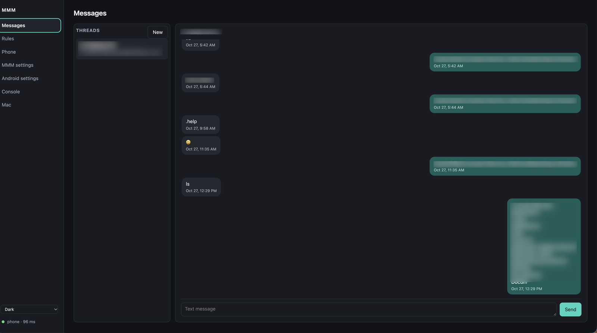
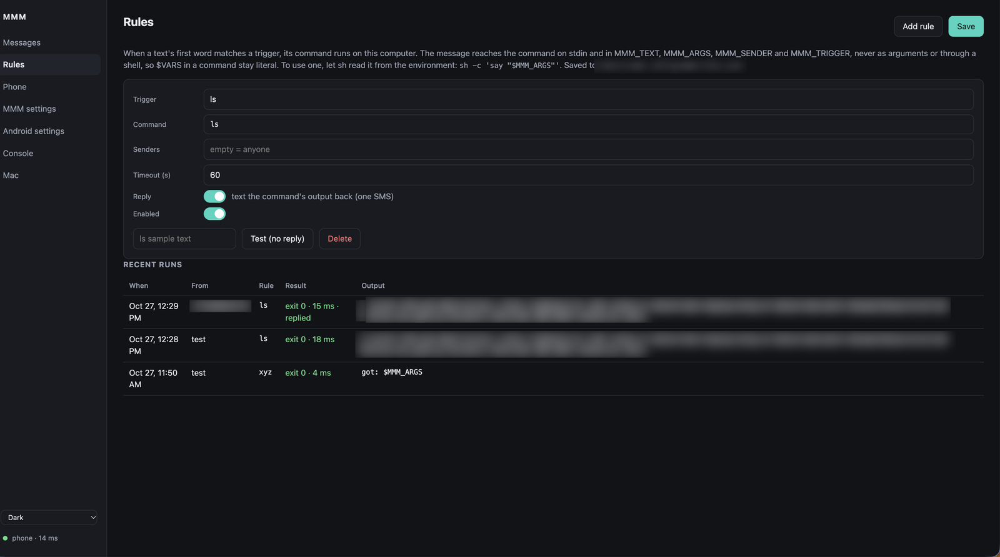
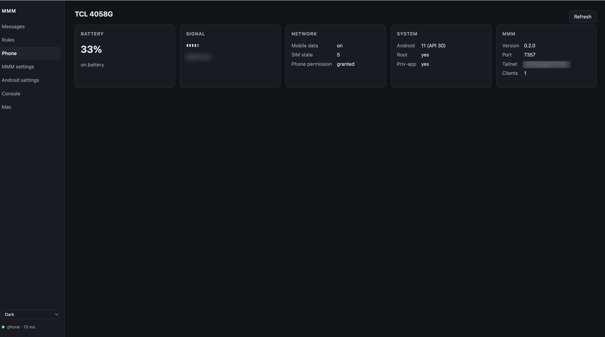
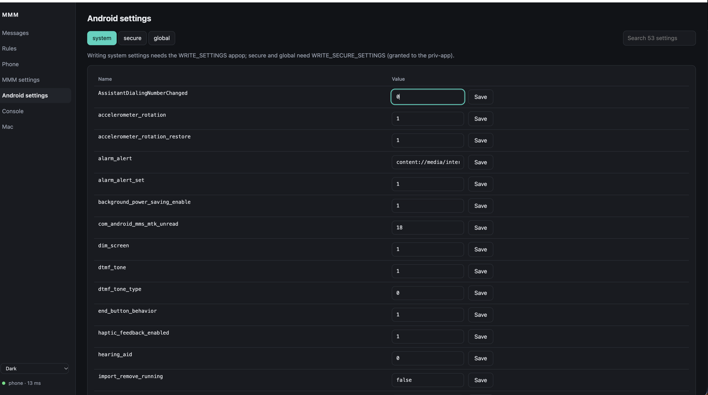
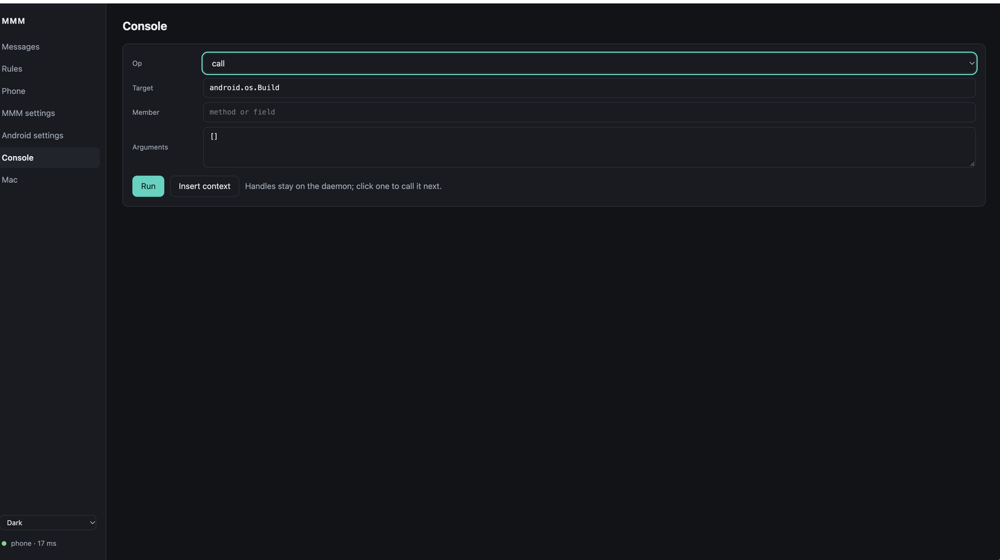
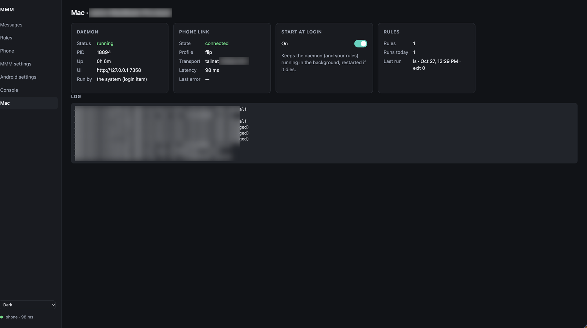

# Web UI and rules — `mmm serve` and `mmm ui`

`mmm serve` is a small daemon on your computer. It holds one connection to the
phone, runs **rules** for incoming texts, and serves a web UI on `127.0.0.1`.
`mmm ui` opens that UI, starting the daemon first if it is not running.

```sh
mmm ui                  # start the daemon if needed, open the page
mmm serve               # run the daemon in the foreground
mmm --profile phone ui  # any profile works; tailnet is the natural one
```

Like the rest of the client it has no dependencies, and it works on macOS and Linux.

## The pages

| Page | Get | Set |
|---|---|---|
| **Messages** | SMS threads, live as texts arrive | Send a text |
| **Rules** | Rules and their recent runs | Edit rules, test one without replying |
| **Phone** | Battery, signal, network, root, priv-app, MMM version | — |
| **MMM settings** | Every app setting | Every app setting (port and tailnet restart the listener) |
| **Android settings** | `Settings.System`, `Secure` and `Global`, searchable | Any of them, given the permission |
| **Console** | Any class, method or field | Any call; Java objects come back as clickable handles |
| **Mac** | Daemon, phone link, rules, log | Start at login |








Writing `Secure` and `Global` settings needs `WRITE_SECURE_SETTINGS`, which the
priv-app holds. `System` settings need the `WRITE_SETTINGS` appop.

## Rules

When a text's first word matches a rule's **trigger**, its **command** runs on your
computer. `*` is a catch-all for texts no other rule matches.

```json
{"rules": [
  {"trigger": "xyz", "command": ["/usr/local/bin/xyz"], "reply": true},
  {"trigger": "*", "command": ["/path/to/assistant"], "timeout": 300}
]}
```

Rules live in `~/.config/mmm/rules.json` (next to `config.toml`) and are edited on
the Rules page; changes apply at once.

| Field | Default | Meaning |
|---|---|---|
| `trigger` | — | One word, case-insensitive, or `*` |
| `command` | — | The argv to run. The page edits it as one line and splits it like a shell would |
| `senders` | `[]` | Numbers allowed to trigger it; empty means anyone. Compared on the last 10 digits |
| `reply` | `false` | Text the command's stdout back to the sender, cut to one SMS (160 characters, 70 with non-ASCII) |
| `timeout` | `60` | Seconds before the command is killed |
| `enabled` | `true` | Off keeps the rule without running it |

### What the command receives

The message is **never** part of the command line and no shell is involved, so
nothing a sender types can be executed. The command gets it as data:

| | |
|---|---|
| stdin | the whole message |
| `MMM_TEXT` | the whole message |
| `MMM_ARGS` | everything after the trigger word (the whole message for `*`) |
| `MMM_SENDER` | the sender's number |
| `MMM_TRIGGER` | the first word |

Because there is no shell, `$MMM_ARGS` written in a command stays literal. To use a
variable, let `sh` read it from the environment — it is then data, not code:

```
sh -c 'say "$MMM_ARGS"'
```

### Each text runs once

The daemon takes texts through a **durable** subscription, so a text that arrives
while it is down is replayed when it comes back (within the app's backlog: 500
events, 24 hours by default). It records each text's event id **before** running
the rule, so a replay never runs a command twice; a crash in the middle costs that
one run rather than repeating it.

Every run — including a blocked sender — is logged with its exit code, duration and
output, on the Rules page and in `~/.local/state/mmm/runs.jsonl`.

## Start at login

The toggle on the Mac page installs a LaunchAgent (`~/Library/LaunchAgents/lubabs770.mmm.serve.plist`)
on macOS, or a `systemd --user` unit (`mmm-serve.service`) on Linux. The system then
keeps the daemon running and restarts it if it dies. Turning it on hands the running
daemon over to the system; the page reconnects by itself.

Commands in rules run with the `PATH` of the shell where you turned this on.

## Security

The UI drives a token that can do anything on the phone, so:

- The daemon listens on **`127.0.0.1` only** and refuses requests whose `Host` is
  not `127.0.0.1:<port>` or `localhost:<port>`, which stops DNS-rebinding attacks.
- Every API call needs a **secret** from `~/.config/mmm/ui-secret` (mode `600`).
  `mmm ui` puts it in the URL fragment, which is never sent over the network; the
  page keeps it for that tab only. Another website open in your browser cannot
  make calls without it.
- The MMM token never reaches the browser.
- The page is served with a strict Content Security Policy and builds every element
  from text, so a message cannot inject markup or script.
- Rules run with **your** user's rights. Treat a rule like a command anyone who knows
  the number can type; give the ones that matter a `senders` list.

## Files

| Path | What |
|---|---|
| `~/.config/mmm/rules.json` | Rules |
| `~/.config/mmm/ui-secret` | The UI secret (`600`) |
| `~/.config/mmm/serve.json` | Pid and port of the running daemon (`600`) |
| `~/.local/state/mmm/serve.log` | Daemon log, rotated at 1 MB |
| `~/.local/state/mmm/runs.jsonl` | Rule runs |
| `~/.local/state/mmm/serve-state.json` | Last handled event id |

`XDG_STATE_HOME` and `MMM_CONFIG` move these as they do for the rest of the client.
